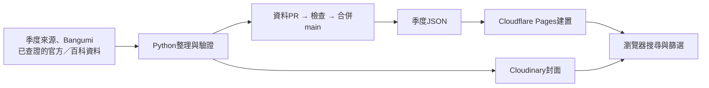

# 動畫新番資訊站

定期整理動畫資料，以季度 JSON 保存，再建置成可搜尋、篩選與分享的靜態網站。

**[正式網站](https://anime-static-crawler.pages.dev/) · [文件入口](docs/README.md) · [目前待辦](docs/後續工作順序.md)**



網站沒有常駐 Python 後端或 SQL 資料庫；訪客讀取已發布的靜態檔案。AniList 自動 API 核對已停用，既有連結保留。詳細元件、資料流、目錄與排程見[架構與資料流](docs/架構與資料流.md)。

## 從這裡開始

| 想做什麼 | 閱讀文件 |
|---|---|
| 快速了解專案與資料現況 | [文件入口](docs/README.md)、[架構與資料流](docs/架構與資料流.md) |
| 安裝、改前端或跑測試 | [開發與測試](docs/開發與測試.md) |
| 設定 GitHub／Cloudflare／Discord | [部署與平台設定](docs/部署與平台設定.md) |
| 補資料、核對集數與引用來源 | [資料查證與品質](docs/資料查證與品質.md)、[集數與播出狀態](docs/集數與播出狀態.md) |
| 處理執行失敗、憑證、備份或復原 | [錯誤診斷與重試](docs/錯誤診斷與重試.md)、[安全維運與災難復原](docs/安全維運與災難復原.md) |
| 找下一項工作或舊查證 | [後續工作順序](docs/後續工作順序.md)、[歷史與證據索引](docs/archive/README.md) |

## 本機只建置網站

需要 Python 3.11；先依[開發手冊](docs/開發與測試.md)安裝鎖定依賴。在已啟用的虛擬環境執行：

```bash
BUILD_ONLY=true python generate_static.py
python manage.py validate-all
python -m http.server 4173 --bind 127.0.0.1 --directory dist
```

PowerShell 的環境變數寫法見開發手冊。此模式不需 `.env`，不執行爬蟲或 Cloudinary 操作。

`dist/data/` 是受 Git 追蹤的核心資料，不能把整個 `dist/` 當暫存資料夾刪除。前端修改 `frontend/` 後，要以 `python manage.py build-frontend` 同步生成 `static/js/main.js`。資料與程式變更均經 PR 與品質檢查；圖片清理及 Git 歷史重寫另依安全手冊處理。
