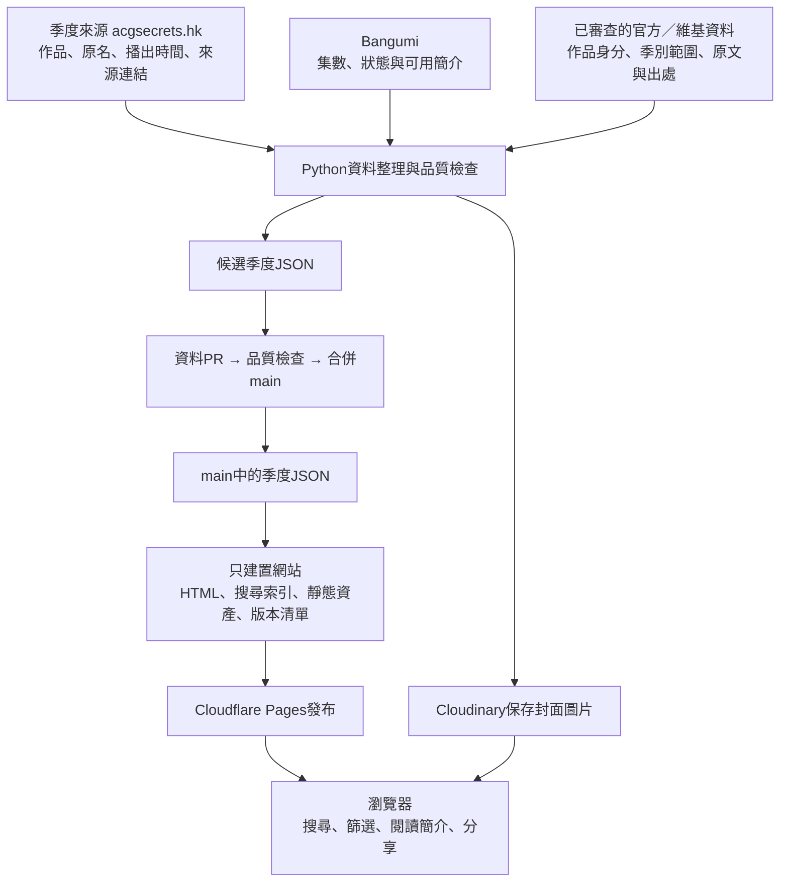
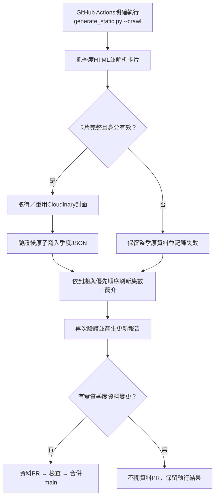
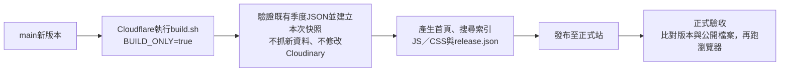

# 架構與資料流

更新：2026-10-23。目前數量、版本與執行結果查詢統一見[文件入口](README.md)，維護邊界見[收斂順序](後續工作順序.md)；本頁只說明現有設計。

> 一句話：Python先把動畫資料查好，存成按季度分檔的JSON，通過PR與檢查後，由Cloudflare Pages發布；訪客用瀏覽器讀取這些檔案。

## 1. 先看全貌

圖中的「整理與檢查」合併畫成一個方塊，詳細順序在下節。圖片可能在資料PR合併前已上傳；正式JSON仍須通過檢查與合併才成為main資料。

AniList自動API核對目前已停用，沒有放入必要路徑。既有連結仍保留作參考。

## 2. 四個區塊，四種責任

| 區塊 | 可以把它想成 | 實際工作 |
|---|---|---|
| Python資料處理 | 資料整理員 | 抓來源、解析、驗證、處理封面、更新集數與保留證據 |
| 季度JSON | 專案的資料庫 | 每季一份資料表，與Git版本一起保存 |
| 網站建置 | 網頁組裝員 | 將現有資料、模板與JS／CSS組成靜態網站 |
| 瀏覽器前端 | 展示與查詢介面 | 讀JSON、篩選、搜尋、開簡介、管理分享清單 |

目前沒有SQL資料庫或常駐Python查詢伺服器。Python在爬蟲、維護、核對與建置時執行；網站平時由Cloudflare Pages提供檔案。

## 3. 每次更新資料，實際走哪一條路？

- 平時抓近期6個季度：前4季、當季、下一季；首次沒有資料時，從2018年冬季開始。未來季度尚未發布與舊季度抓取失敗分開處理。
- 季度抓取、封面處理與集數刷新各有自己的階段；某個來源或圖片失敗，仍讓其他可進行的階段取得機會。整次可能呈現部分失敗，不能寫成全部更新成功。
- 封面服務失敗時，只有同一精確作品才能重用已知圖片；不能套另一作品的圖片。
- 集數刷新按作品身分去重及排程，不表示每天每筆都會重新抓取。官方人工快照也不會因重新建置就更新查證日期。
- 資料PR有審核與保護；自動化程式使用GitHub App建立PR及安排自動合併，受現行合併規則與檢查結果約束。
- 只有季度JSON有實質改變才開自動資料PR。只有圖片快取變更不會單獨提交。

## 4. 發布網站，是另一條流程

本機執行 `python generate_static.py` 預設只讀既有資料建置；只有加上 `--crawl` 才會連線更新資料並可能上傳封面。`BUILD_ONLY=true` 可額外鎖定只建置，與 `--crawl` 同時使用會報錯；`BUILD_ONLY=false` 本身不會啟動爬蟲。

「PR合併」「網站已部署」「正式驗收通過」是三個不同事件。驗收會比對發布清單中的全部公開檔案；當次結果見對應 PR 與正式驗收工作。

同一次建置共用已驗證的資料，避免首頁與索引反覆解析整批 JSON；資料集合或內容在建置途中變動時會拒絕產生新發布清單。快照不跨建置保留，失敗產物須重新建置及驗證後才能發布。

## 5. 使用者打開網站時會發生什麼？

| 使用者動作 | 瀏覽器做的事 |
|---|---|
| 打開首頁／切換季度 | 讀取對應季度JSON並驗證格式 |
| 搜尋關鍵字 | 先讀 search-index.json，找出命中作品並載入必要季度；完整計算總數，卡片每批顯示 60 筆 |
| 同一作品跨季出現 | 依精確身分合併搜尋結果，顯示所屬季度 |
| 篩選星期／狀態 | 依完整匹配結果篩選，不只篩第一批卡片 |
| 展開簡介 | 顯示現有資料；有引用時顯示其來源與署名 |
| 看封面 | 從Cloudinary讀圖片 |
| 加入分享清單／產生圖片 | 最多 20 部，按需載入元件；以匯出開始時的清單快照產圖，有逾時及畫布大小限制 |

瀏覽器不會為了每次搜尋去爬來源網站，也不會呼叫 AniList API。網站使用資料版本與快取，避免混用不同版本的索引與季度資料。同一請求由仍需要結果的畫面共用；最後一位訂閱者取消才停止底層下載，失敗搜尋也取消其餘 worker。分享失敗復原 UI 並保留清單，成功只移除該批已匯出項目，較晚加入的動畫仍保留。

## 6. 資料放在哪裡？

| 位置 | 裝什麼 | 性質 |
|---|---|---|
| dist/data/*.json | 正式季度記錄 | Git追蹤，核心資料 |
| services/reviewed_*.json | 已查證的身分、季別、播出口徑、簡介與引用規則 | Git追蹤，防止下次抓取覆寫正確決定 |
| cloudinary_cache.json | 來源圖片與已處理圖片的快取對應 | 提高重用率，不能取代季度資料 |
| frontend/ | 瀏覽器程式原始模組 | Git追蹤 |
| static/js/main.js | 由前端模組組成的JS檔 | Git追蹤，建置會檢查有無過期 |
| templates/、static/ | HTML模板、CSS、圖片／前端資產 | Git追蹤，建置來源 |
| dist/index.html、dist/static/ | 建置後可直接提供給訪客的網站 | 產物，不直接當主要修改來源 |
| dist/search-index.json | 跨季度搜尋索引 | 建置產物，不能當第二份人工資料庫 |
| dist/release.json | commit、資料版本與公開檔案雜湊 | 驗證「現在網站是哪個版本」 |
| audit-output/、Actions artifact | 執行結果、來源收據、差異、品質與驗收證據 | 不直接作網站顯示資料；artifact有保留期限 |

注意：dist/裡同時有「受Git追蹤的正式資料」與「忽略的建置產物」，不能把整個dist/當成可任意刪除的暫存資料夾。

## 7. 一筆資料的三種身分，不要混淆

| 欄位 | 真正意思 |
|---|---|
| bangumi_id，例如anime-318 | acgsecrets來源卡片ID；名稱容易誤會，它不是Bangumi資料庫編號 |
| external_ids.bangumi | Bangumi資料庫條目ID，可為空 |
| external_ids.anilist | AniList資料庫條目ID，可為空，API停用不刪這個欄位 |

另外：episodes保存集數、已播數、狀態、範圍與查證時間；story_source保存簡介引用來源。作品名稱相近不等於同一季／同一cour，也不會自動推定對應ID。

## 8. 每個平台各做什麼？

| 平台／來源 | 職責 |
|---|---|
| acgsecrets.hk | 季度作品清單、來源卡片與主要播出欄位 |
| Bangumi | 補充條目正篇的集數、狀態與符合範圍的簡介 |
| 官方網站／目錄 | 查證特殊版本、播出口徑及特定已實作的官方更新（例如錢天堂目錄） |
| 維基百科 | 採用經查證、保留固定修訂及授權署名的內容，不是任意全站自動抓取 |
| GitHub | 保存程式與JSON、跑Actions、PR檢查及審核待辦 |
| Cloudflare Pages | 建置及提供靜態網站檔案 |
| Cloudinary | 保存與提供封面圖片 |
| Discord | 爬蟲流程設計中的成功／失敗摘要通知管道 |
| AniList | 自動API核對已停用；既有連結仍作參考 |

Bangumi API與Bangumi Archive來自同一資料系譜，不算兩個獨立資料庫的交叉佐證。人工查證會留下規則與原文證據，不能自行生成簡介或借用別季內容。

## 9. 自動化工作時間表

以下為工作流程檔案的設定，全部換算成台灣時間；排程執行可能延遲。設定了schedule不代表每次都實際執行。

| 工作 | 觸發方式／設定時間 | 功能 |
|---|---|---|
| 每日爬蟲 | 每日01:00；另受CRAWLER_SCHEDULE_ENABLED=true控制 | 更新資料、需要時開資料PR |
| 來源選擇器檢查 | 每日09:15 | 偵測來源HTML改版或卡片解析異常 |
| 資料來源核對 | 每週一10:30 | 核對已收錄季度、官方快照、來源差異；AniList API停用 |
| 到期待查提醒 | 每日11:00 | 處理有明確 C 待查日期的審核提醒 |
| 品質與Windows檢查 | PR或main push | 測試與建置檢查 |
| 品質證據／正式站驗收 | main push | 保存品質趨勢、確認實際部署與版本 |
| Cloudinary清理計畫／執行 | 人工workflow_dispatch | 有保護條件的計畫與刪除流程，不是每日自動刪圖 |

爬蟲開關須以 GitHub repository variable 的實際值核對，工作流程檔案不能證明目前已啟用。當次執行與正式版本的[查詢方式](README.md#資料與發布基準)及[歷史案例](archive/README.md#事故與過渡操作)分開保存；schedule、workflow_dispatch、push 與 PR 不互相代替。

## 10. 為什麼查不到資料時不直接覆寫？

- 整季解析不完整、舊卡片消失或ID衝突：保留原季，記錄問題。
- 外部來源失敗：保留可靠資料；最後嘗試不當成最後成功。
- 簡介版本不清楚：保留缺漏，不借母作品或另一cour。
- 預定總集數：只表示預定，不當成已播進度。
- 已審查的正確內容：由reviewed規則保護，避免下一次抓取覆寫。
- Cloudinary刪除：走獨立人工保留流程，不在一般網站建置中執行。

## 11. 想改東西，先找哪裡？

| 想處理的事 | 優先看 |
|---|---|
| 網站畫面與操作 | templates/、static/css/、frontend/ |
| 季度來源抓取與解析 | services/http_client.py、services/parser.py |
| 圖片處理與快取 | services/image_store.py、services/cache_repository.py |
| 季度資料寫入與保護 | models.py、services/data_repository.py |
| 集數、狀態與刷新政策 | services/episode_metadata.py、services/episode_refresh.py |
| 人工查證與範圍口徑 | services/reviewed_*.json及對應review模組 |
| 爬蟲各階段如何串起來 | services/update_pipeline.py |
| 網頁、索引與版本如何產生 | generate_static.py、services/search_index.py、services/release_manifest.py |
| 每週核對與審核待辦 | services/source_audit.py、services/review_notifications.py、services/review_queue.py |
| 排程、CI與發布 | .github/workflows/、build.sh |
| 正式站版本不一致 | verify_production.py、services/production_verification.py |

日常命令見[開發與測試](開發與測試.md)，平台設定見[部署手冊](部署與平台設定.md)，舊架構報告見[歷史索引](archive/README.md)。
